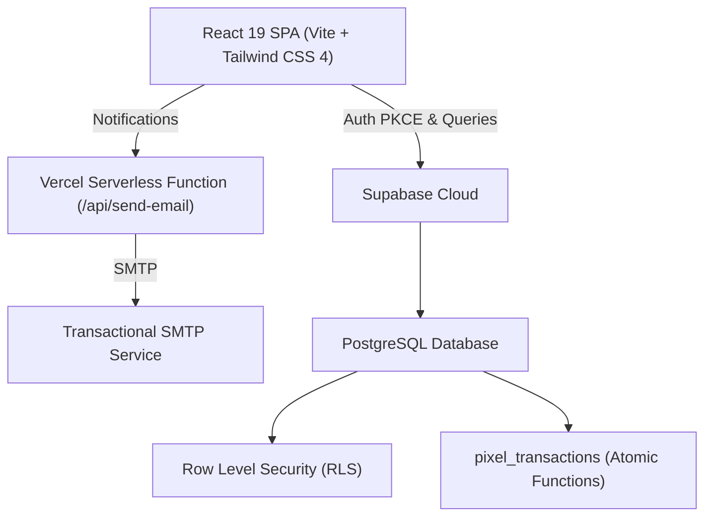

# Pixel Minds

> The open-source community platform for builders, students, and tech enthusiasts to discover hackathons, explore curated opportunities, collaborate in community discussions, and earn gamified Pixel rewards.

[](https://github.com/ADHARV-S-RAVI/Pixel-Minds/actions/workflows/ci.yml)
[](#license)
[](https://nodejs.org/)
[](https://vitejs.dev/)
[](https://react.dev/)
[](https://supabase.com/)

---

## 📌 Table of Contents

- [About the Project](#about-the-project)
- [Key Features](#key-features)
- [Screenshots & Preview](#screenshots--preview)
- [Architecture & Tech Stack](#architecture--tech-stack)
- [Getting Started](#getting-started)
  - [Prerequisites](#prerequisites)
  - [Installation](#installation)
  - [Environment Variables](#environment-variables)
  - [Database Setup (Supabase)](#database-setup-supabase)
  - [Running Locally](#running-locally)
- [Available Scripts](#available-scripts)
- [Deployment](#deployment)
- [Contributing](#contributing)
- [Security](#security)
- [License](#license)
- [Community & Support](#community--support)

---

## 🌟 About the Project

Students and early-career developers often struggle to find legitimate hackathons, internships, fellowships, and tech grants across fragmented platforms.

**Pixel Minds** provides a unified, community-powered ecosystem where builders can:
1. **Discover** verified opportunities with structured deadlines, eligibility criteria, and direct application links.
2. **Submit & Curate** community opportunities through an admin moderation queue.
3. **Engage in the Community Feed** by discussing ideas, sharing hackathon registrations, tagging builders with `@username` mentions, and bookmarking posts across devices.
4. **Earn Pixels & Climb Leaderboards**: Every positive action—such as creating insightful posts or submitting verified opportunities—awards Pixels tracked in an auditable double-entry ledger.

---

## 🚀 Key Features

- **🎯 Opportunities Hub**: Filter opportunities by category (Hackathons, Internships, Grants, Fellowships, Open Source), mode (Online, In-Person, Hybrid), and active deadlines.
- **💬 Community Discussion Feed**:
  - Live feed with hashtag parsing (`#ai`, `#web3`) and dynamic `@builder` mentions.
  - Asynchronous autocomplete for usernames with debounced lookup.
  - Safe external link previewing with strict protocol verification (`http:` and `https:`).
  - Repost and share tracking with duplicate prevention.
  - Cross-device bookmark synchronization.
- **💎 Gamified Pixel Rewards & Ledger**:
  - Atomic PostgreSQL ledger (`pixel_transactions`) with idempotency keys.
  - Earn Pixels for community posts, verified opportunity submissions, and referrals.
  - Immutable balance updates enforced via database `SECURITY DEFINER` functions.
  - Global Leaderboard ranking builders by total Pixels and tier ranks.
- **📬 Transactional Email Notifications**:
  - Automated transactional email confirmations for opportunity applications and submissions using serverless edge handlers.
- **🛡️ Enterprise-Grade Security**:
  - PostgreSQL Row Level Security (RLS) on all user data, comments, posts, and transactions.
  - Input sanitization against script/XSS injection.
  - Role-based authorization (`user` vs. `admin`).
- **🌓 Theme Engine**:
  - Responsive, glassmorphism design with seamless Dark and Light mode toggling.

---

## 📸 Screenshots & Preview

<!-- Placeholders for visual previews. Replace with actual asset paths when publishing screenshots. -->

| Opportunities Feed | Community Discussions |
| :---: | :---: |
|  <br> *Explore verified tech opportunities* |  <br> *Builder discussions and updates* |

| Builder Profile & Ledger | Submission Dashboard |
| :---: | :---: |
|  <br> *Pixel balance, badges, and history* |  <br> *Track submitted events and review status* |

---

## 🏗️ Architecture & Tech Stack



### Technology Stack
- **Frontend**: [React 19](https://react.dev/), [TypeScript](https://www.typescriptlang.org/), [Vite 8](https://vitejs.dev/)
- **Styling**: [Tailwind CSS 4](https://tailwindcss.com/) with PostCSS
- **Icons & Motion**: [Lucide React](https://lucide.dev/), [GSAP](https://gsap.com/)
- **Routing**: [React Router DOM v7](https://reactrouter.com/)
- **Linter**: [Oxlint](https://oxc.rs/)
- **Backend & Database**: [Supabase](https://supabase.com/) (PostgreSQL 15+, Supabase Auth, Row Level Security)
- **Serverless API**: Vercel Serverless Functions (`api/send-email.ts`) + [Nodemailer](https://nodemailer.com/)

---

## 🛠️ Getting Started

Follow these instructions to set up the project locally for development and testing.

### Prerequisites

Ensure you have the following installed on your machine:
- **Node.js**: `v18.0.0` or higher (Node.js 20 LTS recommended)
- **npm**: `v9.0.0` or higher
- **Git**: For version control
- A free **[Supabase](https://supabase.com/)** account for database and authentication

### Installation

1. **Fork the repository** on GitHub by clicking the **Fork** button at the top right of the repo page.
2. **Clone your fork** locally:
   ```bash
   git clone https://github.com/<YOUR_GITHUB_USERNAME>/Pixel-Minds.git
   cd Pixel-Minds
   ```
3. **Install dependencies**:
   ```bash
   npm install
   ```

### Environment Variables

1. Copy the example environment template:
   ```bash
   cp .env.example .env
   ```
2. Open `.env` and fill in your Supabase configuration:
   ```env
   # Supabase Configuration
   VITE_SUPABASE_URL=https://your-project-ref.supabase.co
   VITE_SUPABASE_PUBLISHABLE_KEY=your-supabase-publishable-or-anon-key

   # Optional: Serverless Email Dispatcher (for /api/send-email notifications)
   SMTP_HOST=smtp.gmail.com
   SMTP_PORT=587
   SMTP_USER=your-email@example.com
   SMTP_PASS=your-app-password
   SMTP_FROM="Pixel Minds <your-email@example.com>"
   ```

### Database Setup (Supabase)

1. Create a new project in the [Supabase Dashboard](https://supabase.com/dashboard).
2. Navigate to the **SQL Editor** in your Supabase project dashboard.
3. Apply the base schema:
   - Open and copy the contents of [`supabase/schema.sql`](supabase/schema.sql).
   - Paste into the SQL Editor and execute it to create baseline tables, triggers, and functions.
4. Apply the database migrations in sequential timestamp order from [`supabase/migrations/`](supabase/migrations/):
   - Migrations apply enhancements such as date validation, secure registration cooldowns, unique usernames/mentions, cross-device bookmarks, and atomic Pixel ledger tracking.
   - Specifically verify that `20261114_pixel_ledger_integrity.sql`, `20261114_fix_pixel_ledger_schema.sql`, and `20261114_correct_pixel_rewards_and_bookmarks.sql` are applied.
5. In your Supabase Dashboard:
   - Under **Authentication** -> **URL Configuration**, add your local development URL (`http://localhost:5173`) to **Site URL** and **Redirect URLs** (e.g., `http://localhost:5173/**`).
6. **Setting Up an Admin User (Optional for Testing Moderation)**:
   - By default, all newly registered accounts have `role = 'user'`.
   - To access the Admin moderation queue and adjust site settings, sign up through the application UI, then in the Supabase Table Editor navigate to `public.profiles` and update your user's row: set `role` to `'admin'`.

### Running Locally

Start the Vite development server:
```bash
npm run dev
```
Open your browser and navigate to `http://localhost:5173`.

---

## 📜 Available Scripts

In the project root, you can run:

- `npm run dev`: Starts the local development server with Hot Module Replacement (HMR).
- `npm run build`: Type-checks the codebase using TypeScript compiler (`tsc -b`) and generates production bundles via Vite (`vite build`).
- `npm run lint`: Runs [Oxlint](https://oxc.rs/) to quickly detect syntax errors and anti-patterns.
- `npm run preview`: Locally previews the generated production build.

---

## 🚀 Deployment

### Deploying to Vercel

1. Push your code to your GitHub repository.
2. Import your repository in [Vercel](https://vercel.com/).
3. Framework Preset: **Vite**.
4. Configure Environment Variables in the Vercel Project Settings:
   - `VITE_SUPABASE_URL`
   - `VITE_SUPABASE_PUBLISHABLE_KEY`
   - (Optional) `SMTP_HOST`, `SMTP_PORT`, `SMTP_USER`, `SMTP_PASS` if enabling email notifications.
5. Deploy! Vercel automatically detects the build output directory (`dist`) and deploys the serverless functions in `/api`.

---

## 🤝 Contributing

We welcome contributions from builders worldwide! Whether fixing bugs, improving documentation, or adding new features:

1. Read our [Contributing Guide](CONTRIBUTING.md) for details on code style, branch conventions, and testing.
2. Adhere to our [Code of Conduct](CODE_OF_CONDUCT.md).
3. Search [existing issues](https://github.com/ADHARV-S-RAVI/Pixel-Minds/issues) before opening a new one.

---

## 🔒 Security

We take security and data integrity seriously. If you discover a vulnerability or security bug, please review our [Security Policy](SECURITY.md) and report it responsibly. **Do not disclose security vulnerabilities in public issues or comments.**

---

## 📄 License

Pixel Minds is open source under the **MIT License**. See the [LICENSE](LICENSE) file for details.

---

## 💬 Community & Support

- **Bug Reports & Feature Requests**: Use [GitHub Issues](https://github.com/ADHARV-S-RAVI/Pixel-Minds/issues).
- **Questions & Discussions**: See [SUPPORT.md](SUPPORT.md).
- **Official Contact**: info.pixellminds@gmail.com
