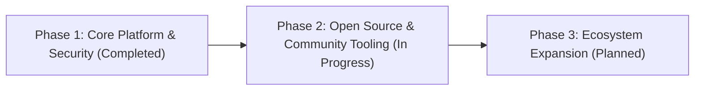

# Pixel Minds Roadmap

This document outlines the development direction, verified milestones, and planned enhancements for Pixel Minds.

---

## 🏁 Phase Status Overview

---

## ✅ Completed Milestones

### Core Platform & Authentication
- [x] Responsive React 19 + Vite 8 SPA architecture with Tailwind CSS 4.
- [x] Supabase Auth integration supporting PKCE authentication flow and email OTP verification.
- [x] Unified Dark and Light glassmorphism design system.
- [x] Dynamic user profile management with customizable bio, avatar, education details, and unique usernames.

### Opportunities Engine
- [x] Filterable opportunity catalog by category, mode, eligibility, and deadline status.
- [x] Community opportunity submission workflow with admin moderation queue.
- [x] Automated status tracking and opportunity application confirmations via transactional emails.

### Community Feed & Engagement
- [x] Live interactive feed with category tags, hashtags, and builder mentions.
- [x] Real-time debounced builder search for `@mention` autocomplete.
- [x] Duplicate-safe reposts and share tracking.
- [x] User-scoped cross-device bookmarking synchronized via Supabase.
- [x] Full optimism and error rollbacks on likes, comments, and deletions.

### Gamified Pixel Rewards & Ledger
- [x] PostgreSQL double-entry transaction ledger (`pixel_transactions`) with unique idempotency keys.
- [x] Atomic balances maintained via `SECURITY DEFINER` procedures with row-level locks.
- [x] Global Leaderboard ranking builders by verified Pixel counts and achievement tiers.

---

## 🚧 In Progress

### Open Source Standardization
- [x] Comprehensive documentation (`README.md`, `CONTRIBUTING.md`, `SECURITY.md`, `SUPPORT.md`).
- [x] GitHub Community templates (Bug reports, Feature requests, Documentation, Pull requests).
- [ ] Automated continuous integration (CI) pipeline validating TypeScript compiles and Oxlint syntax checks on all pull requests.
- [ ] Dependabot configuration for scheduled dependency monitoring.
- [ ] Automated Supabase CLI migration and local testing harnesses.

---

## 🔮 Planned Enhancements (Future Releases)

### 1. Calendar & Event Integrations
- [ ] "Add to Calendar" (Google Calendar / iCal `.ics` export) for opportunity application deadlines.
- [ ] Push notification / browser reminder support for bookmarked opportunities approaching deadlines.

### 2. Hackathon Teammate Matching
- [ ] "Find Teammates" feature on Hackathon opportunity cards, allowing solo builders to post availability and connect based on tech stacks.

### 3. Extended Achievements & Badges
- [ ] Expanded automated badge unlocks (e.g., First Hackathon Shared, Top 10 Monthly Contributor, Community Mentor).
- [ ] Public builder profile vanity URLs (`/u/username`).

### 4. Progressive Web App (PWA)
- [ ] PWA offline support for browsing cached opportunities and offline bookmarked posts.

---

## 💡 Proposing a Roadmap Item

Have a suggestion for the roadmap?
1. Open a [Feature Request](.github/ISSUE_TEMPLATE/feature_request.md).
2. Discuss the use case and implementation feasibility with the community.

